<div align="center">

# ARENA

### Automated Retrieval & Evaluation Nexus Architecture

**Find out *why* a RAG system gets answers wrong, not just *that* it does.**

[](https://rag-autopsy.vercel.app)
[](#acknowledgements)


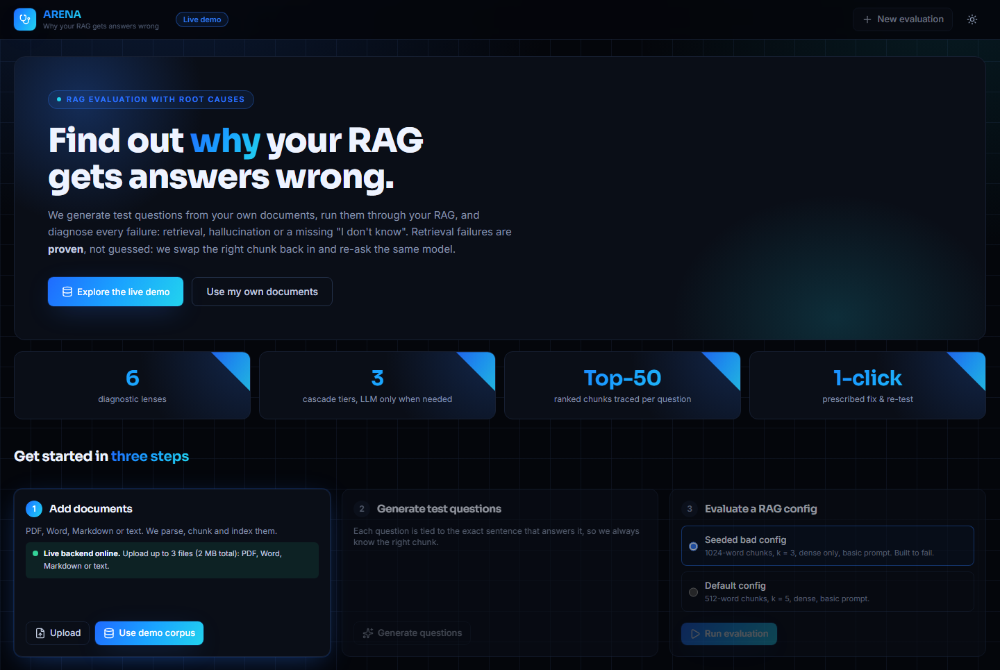

</div>

---

## Table of contents

1. [The problem](#the-problem)
2. [What ARENA does](#what-arena-does)
3. [Live demo](#live-demo)
4. [Screenshots](#screenshots)
5. [System architecture](#system-architecture)
6. [How it works](#how-it-works)
7. [Results on the demo corpus](#results-on-the-demo-corpus)
8. [Tech stack](#tech-stack)
9. [Project structure](#project-structure)
10. [Getting started](#getting-started)
11. [Deployment](#deployment)
12. [API reference](#api-reference)
13. [Testing](#testing)
14. [Limitations and roadmap](#limitations-and-roadmap)
15. [Acknowledgements](#acknowledgements)

More detail: **[PROJECT_GUIDE.md](PROJECT_GUIDE.md)** (file-by-file walkthrough and Q&A) ·
**Slides:** [RAG_Autopsy_HYPNEXIS26.pptx](RAG_Autopsy_HYPNEXIS26.pptx)

---

## The problem

RAG (retrieval-augmented generation) chatbots answer questions from documents. When an answer is wrong, there are
three very different causes, and each needs a different fix:

| Root cause | What happened | Typical fix |
|---|---|---|
| **Retrieval** | The right passage never reached the model (ranked too low, not found, or cut in half by chunking) | Reranker, hybrid search, smaller chunks |
| **Generation** | The right passage was there, but the model invented facts or misread it | Grounded prompt, stronger model |
| **Abstention** | The documents can't answer the question, but the model answered anyway instead of "I don't know" | Grounded prompt that allows abstaining |

Existing evaluation tools (RAGAS, TruLens, …) mostly report aggregate scores such as "faithfulness 0.71": a fever
reading, not a diagnosis. LLM-as-judge verdicts are opinions. Teams end up tuning chunk size, top-k and prompts by trial
and error.

## What ARENA does

- **Builds a test set from your own documents.** Every question keeps the exact *gold* sentence that answers it, so we
  always know which chunk the retriever should have found.
- **Diagnoses every answer with a three-tier cascade of "lenses".** Cheap local checks run on every question; LLM calls are
  spent only on uncertain or contested cases.
- **Proves retrieval failures with a counterfactual.** Re-ask the *same* model with *only* the gold chunk: if the answer
  becomes correct, retrieval was at fault. If it stays wrong, the generator was.
- **Gives every failure a root cause, a sub-cause and a confidence**, combined by a weighted vote, and flags uncertain
  cases for human review.
- **Prescribes a config change and verifies it.** One click re-runs only the failed questions with the fix and shows
  what was fixed, what broke, and how each scorecard moved.
- **Reports honest numbers:** four scorecards with 95% bootstrap confidence intervals, plus the LLM cost per question.

## Live demo

**https://rag-autopsy.vercel.app**

- **Explore the live demo** opens the seeded bad-config run: 83 questions, 12 diagnosed failures, all autopsies, and the
  before/after re-test. This part is built into the site and always works.
- **Use my own documents** uploads up to 3 files (PDF, Word, Markdown, text; 2 MB total), generates questions and runs a
  full evaluation. This needs the team's backend to be online (see [Deployment](#deployment)); the page shows
  "Live backend online/offline".
- Best single example, a retrieval failure **proven** by counterfactual:
  [rag-autopsy.vercel.app/?run=93234dfc0c&q=q_d142cc2b](https://rag-autopsy.vercel.app/?run=93234dfc0c&q=q_d142cc2b)

## Screenshots

**Run overview.** Four scorecards with confidence intervals, the root-cause mix, the cascade's LLM cost, and the
recommended fix.

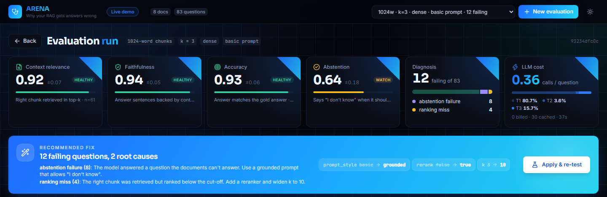

**Question autopsy.** The failing question, expected answer, verdict confidence, the "proven by counterfactual" callout,
the answer coloured sentence by sentence, and the ranked chunks with the gold chunk outlined below the k cut-off.

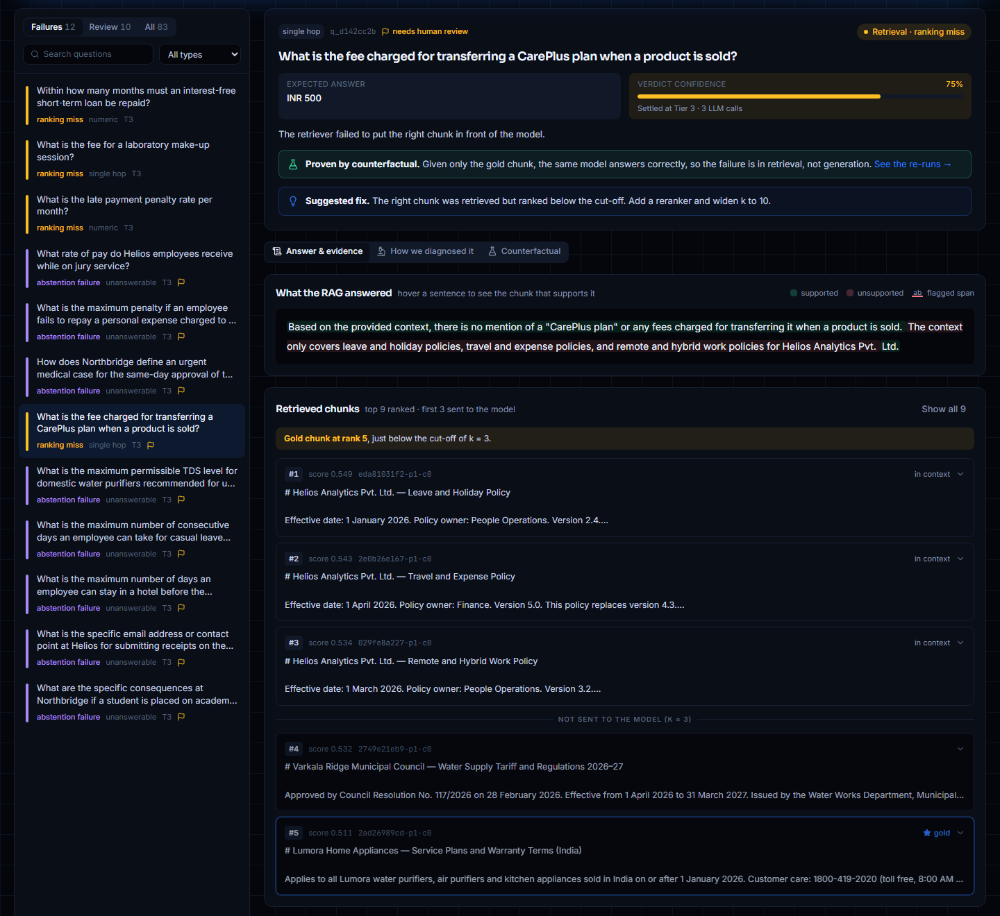

<table>
<tr>
<td width="50%"><b>How we diagnosed it.</b> Each lens votes with weight × confidence; the strongest verdict wins.<br/>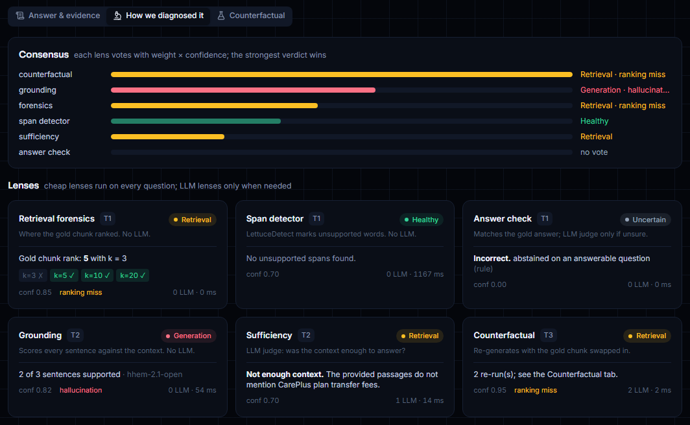</td>
<td width="50%"><b>Counterfactual proof.</b> Same model, same question: wrong with the retrieved chunks, right with only the gold chunk.<br/>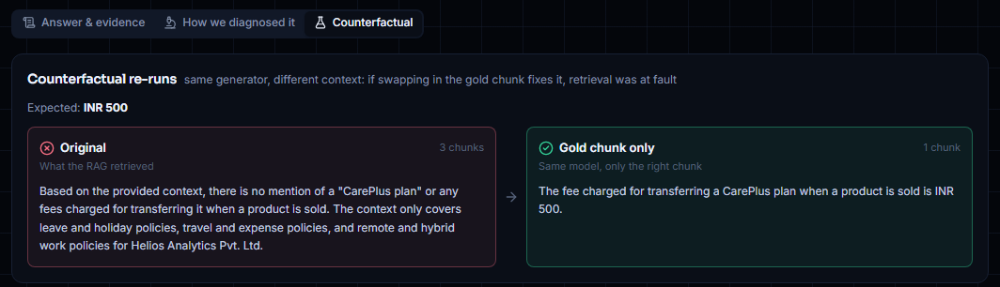</td>
</tr>
<tr>
<td><b>Apply &amp; re-test.</b> The prescribed fix (reranker, k = 10, grounded prompt) fixes 10 of 12 failures and breaks none.<br/>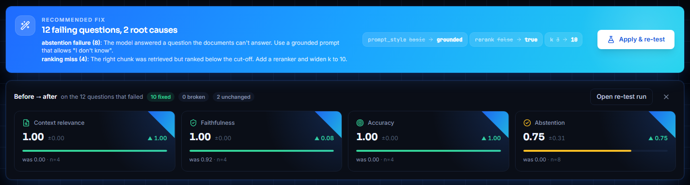</td>
<td><b>Upload your own documents.</b> Live backend status, file confirmation, and the generated question mix.<br/>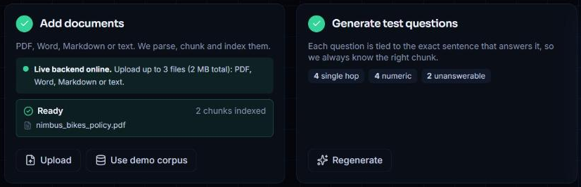</td>
</tr>
</table>

**Light theme.** Dark is the default; the toggle in the header switches themes.

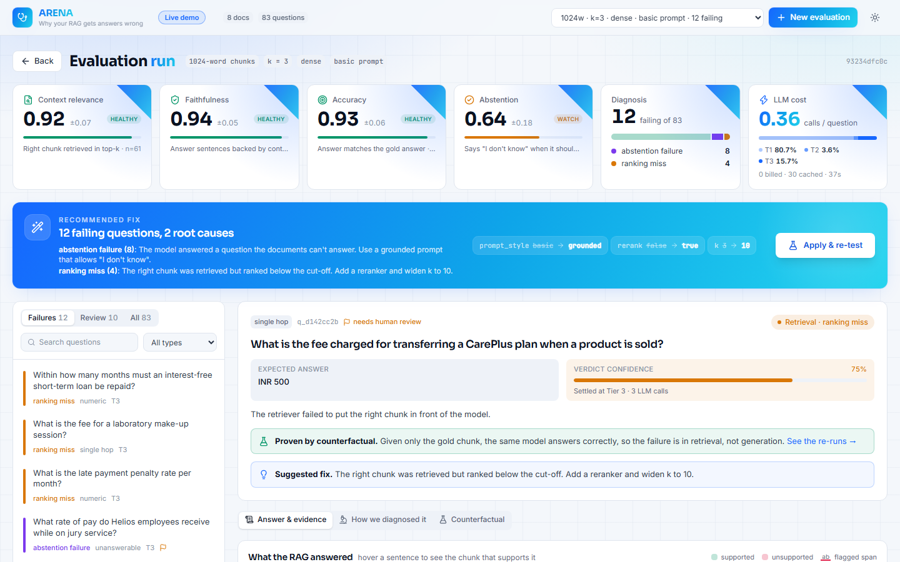

## System architecture

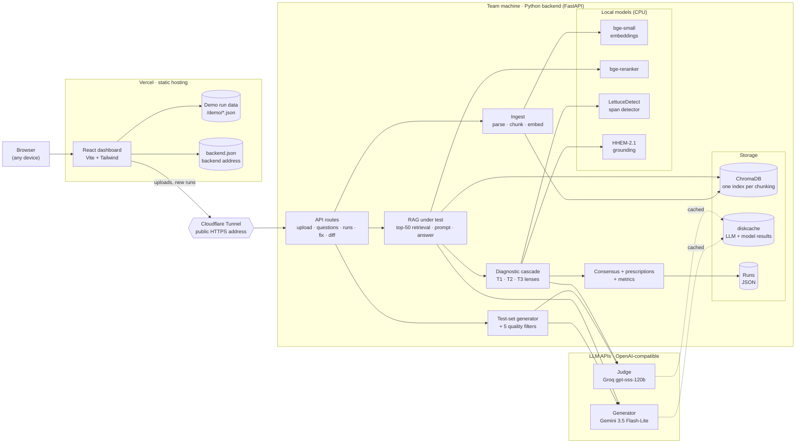

| Component | Role |
|---|---|
| **React dashboard** (Vercel) | One-page app: setup, overview, failure list, autopsy, fix loop. The demo run ships as static JSON, so it works even when the backend is off. |
| **Cloudflare Tunnel** | Gives the backend on the team's machine a public HTTPS address; the dashboard reads it from `backend.json`. |
| **FastAPI backend** | Ingests documents, writes the test set, runs the RAG under test and the cascade, stores runs. |
| **Local models** | Embeddings, reranker, LettuceDetect and HHEM run on CPU with no API calls. |
| **LLM APIs** | Generator (Gemini) answers questions and writes the test set; a *different-family* judge (Groq) checks correctness and sufficiency. |
| **diskcache** | Every LLM call and checker-model result is cached by its inputs, so any re-run is free and fast. |

## How it works

### Pipeline

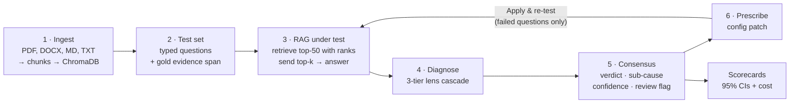

### 1. Ingest
Documents are parsed (PyMuPDF; tables via pdfplumber; python-docx for Word), split into fixed-size word windows with
overlap, embedded with `bge-small-en-v1.5` and stored in ChromaDB, one collection per *(corpus, chunk size, overlap)*.
Every chunk remembers its character offsets in the page.

### 2. Test-set generation
One LLM call per chunk writes **single-hop** and **numeric** questions, each with an answer and the **exact evidence
sentence**; **unanswerable** questions are written per document. Every candidate must pass five filters:

1. The evidence sentence must actually be found in the chunk (no invented evidence).
2. No copying more than 8 consecutive words from the chunk (leakage).
3. No near-duplicates (embedding cosine > 0.9).
4. A judge confirms it is answerable from its chunk, or, for unanswerable ones, *not* answerable from what retrieval finds.
5. A closed-book check flags questions the model can answer from memory alone.

The gold answer is stored as a **character span**, so the gold chunks can be found again under *any* chunk size. That is
what lets the fix loop change the chunking and still evaluate fairly.

### 3. The diagnostic cascade

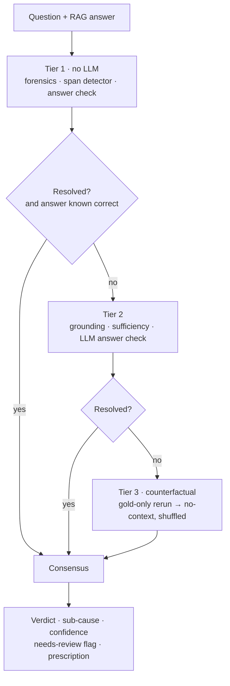

| Tier | Lens | LLM? | What it decides |
|---|---|---|---|
| 1 | **Forensics** | No | Rank of the gold chunk: within k → retrieval OK; k+1…20 → *ranking miss*; deeper → *recall miss*; evidence cut across chunks → *chunking miss*. Also a k-sweep (k = 3/5/10/20). |
| 1 | **Span detector** | No | LettuceDetect marks answer words not supported by the context. Long contexts are split; a word counts as unsupported only if *every* group flags it. |
| 1 | **Answer check** | Only if unsure | "I don't know" rule for unanswerable questions; lexical match for the rest, then an LLM judge if inconclusive. |
| 2 | **Grounding** | No | HHEM (or MiniCheck on a GPU) scores each sentence against ~300-word windows of each chunk and records which chunk supports it. |
| 2 | **Sufficiency** | 1 call | Judge: was the retrieved context enough to answer? |
| 3 | **Counterfactual** | 2–6 calls | Re-generate with **only the gold chunk**. Correct now → retrieval failure, proven. Still wrong → generation failure. |

**Resolved** means one lens is ≥ 80% confident and no other lens ≥ 60% confident contradicts it. Any answer that is not
known to be correct always goes to at least Tier 2.

### 4. Consensus
Each verdict scores Σ (weight × confidence) of the lenses voting for it, with weights **counterfactual 3.0 · grounding 2.0 ·
forensics 1.5 · span detector 1.5 · sufficiency 1.0 · answer check 1.0**. Confidence is the winner's share of the vote.
A question is flagged **needs review** when confidence < 0.6, when the two grounding checkers strongly disagree, or when
an "unanswerable" test question turns out to be fully supported (possibly a mislabelled test).

### 5. Prescriptions

| Sub-cause | Config patch |
|---|---|
| `ranking_miss` | `rerank = true`, `k = 10` |
| `recall_miss` | `retrieval = hybrid` (dense + BM25 with reciprocal rank fusion) |
| `chunking_miss` | `chunk_size = 256`, `chunk_overlap = 96` |
| `hallucination`, `misread_incomplete`, `lucky_guess` | `prompt_style = grounded` |
| `abstention_failure` | `prompt_style = grounded` (cite passages, allow "I don't know") |

### 6. Scorecards
**Context relevance** (gold chunk within top-k), **faithfulness** (supported sentences), **accuracy** (matches the gold
answer) and **abstention** (says "I don't know" when it should), each with a **95% bootstrap confidence interval**
(1,000 resamples). Cost: LLM calls per question and the share settled at each tier.

## Results on the demo corpus

Eight fictional documents (university handbook and scholarships, a water-purifier manual and warranty terms, three HR
policies, a water tariff). The facts are invented so the model can't answer from memory, with look-alike numbers across
documents as distractors. 83 questions: 31 single-hop, 30 numeric, 22 unanswerable.

| | Seeded bad config<br/><sub>1024-word chunks · k = 3 · dense · basic prompt</sub> | After the prescribed fix<br/><sub>+ reranker · k = 10 · grounded prompt</sub> |
|---|---|---|
| Failures found | **12** (4 ranking misses, 8 abstention failures) | **10 fixed, 0 broken**, 2 unchanged |
| Context relevance (failed set) | 0.00 | **1.00** |
| Accuracy (failed set) | 0.00 | **1.00** |
| Abstention (failed set) | 0.00 | **0.75** |
| Faithfulness (failed set) | 0.92 | **1.00** |

- **Cost:** 0.36 LLM calls per question on average; **81%** of questions are settled at Tier 1 with no LLM call.
- **Speed:** a cold restart replays the whole demo in **51 s** from cache, 17 s warm.

## Tech stack

| Layer | Choice |
|---|---|
| Backend | Python 3.11, FastAPI, Pydantic v2, asyncio |
| Parsing | PyMuPDF, pdfplumber, python-docx |
| Retrieval | ChromaDB, `BAAI/bge-small-en-v1.5`, `rank_bm25` + reciprocal rank fusion, `BAAI/bge-reranker-base` |
| Checkers (no LLM) | LettuceDetect (ModernBERT), HHEM-2.1-Open; MiniCheck Flan-T5-Large optional |
| LLMs | Any OpenAI-compatible API; demo uses Gemini 3.5 Flash-Lite (generator) and Groq gpt-oss-120b (judge) |
| Caching | diskcache (SQLite) |
| Frontend | React 19, Vite, TypeScript, Tailwind CSS 4, lucide-react |
| Hosting | Vercel (dashboard) + Cloudflare Tunnel (backend) |
| No frameworks | No LangChain / LlamaIndex: every step is plain, explainable code |

## Project structure

```
rag-autopsy/
├── backend/
│   ├── app/
│   │   ├── main.py              FastAPI app
│   │   ├── config.py            .env, paths, limits, consensus weights
│   │   ├── schemas.py           Chunk, TestQuestion, RagConfig, RagTrace, LensResult, Diagnosis
│   │   ├── store.py             run persistence (JSON)
│   │   ├── llm/client.py        the only LLM client: cache, rate limits, JSON parsing, call counting
│   │   ├── ingest/              parser.py · chunker.py · indexer.py
│   │   ├── rag/                 retriever.py · pipeline.py   (the RAG under test)
│   │   ├── generator/           prompts.py · generate.py · filters.py
│   │   ├── lenses/              forensics · span_detector · answer_check · grounding · sufficiency · counterfactual
│   │   ├── cascade/             runner.py · consensus.py · prescriptions.py
│   │   ├── metrics/aggregate.py scorecards, bootstrap CIs, cost
│   │   └── api/routes.py        HTTP API
│   ├── scripts/                 smoke_rag · gen_questions · run_eval · prewarm_demo · export_static · smoke_checkers
│   └── tests/                   25 unit tests (LLM mocked)
├── web/                         React dashboard
│   └── src/                     App.tsx · api.ts · ui.tsx · components/
├── demo/                        8 fictional demo documents
├── deploy/
│   ├── go-live.sh               start the tunnel and point the live site at it
│   └── hf-space/                Docker Space package (needs Hugging Face PRO)
├── docs/images/                 screenshots used in this README
├── PROJECT_GUIDE.md             detailed walkthrough + judge Q&A
└── RAG_Autopsy_HYPNEXIS26.pptx  presentation
```

## Getting started

### Prerequisites
- Python 3.11, Node 18+ (tested with Node 24), Git
- About 3 GB of disk space for the local models; runs on CPU (16 GB RAM laptop tested)
- Two OpenAI-compatible LLM endpoints for generator and judge (free tiers of Google Gemini and Groq work)

### 1. Backend

```bash
cd backend
py -3.11 -m venv .venv                     # python3.11 -m venv .venv on macOS/Linux
.venv/Scripts/python -m pip install torch --index-url https://download.pytorch.org/whl/cpu
.venv/Scripts/python -m pip install -r requirements.txt
.venv/Scripts/python -m pip install lettucedetect accelerate
# optional, GPU only: .venv/Scripts/python -m pip install "minicheck @ git+https://github.com/Liyan06/MiniCheck.git@main"
```

Create `.env` in the repo root (copy `.env.example`):

```ini
# Judge (and default for both roles): Groq
LLM_BASE_URL=https://api.groq.com/openai/v1
LLM_API_KEY=gsk_...
JUDGE_MODEL=openai/gpt-oss-120b
# Generator (the RAG under test): Google Gemini
GEN_BASE_URL=https://generativelanguage.googleapis.com/v1beta/openai/
GEN_API_KEY=...
GEN_MODEL=gemini-3.5-flash-lite
LLM_MAX_CONCURRENCY=3
DEVICE=cpu
GROUNDING_MODEL=hhem          # minicheck needs a GPU to be practical
# Limits while the backend is public (0 = unlimited)
UPLOAD_MAX_FILES=3
UPLOAD_MAX_MB=2
GEN_MAX_CHUNKS=12
```

Use a judge from a **different model family** than the generator, so the judge doesn't favour its own family's
answers. `.env` is git-ignored; never commit it.

```bash
.venv/Scripts/python -m uvicorn app.main:app --port 8000
```

### 2. Dashboard

```bash
cd web
npm install
npm run dev            # http://localhost:5173 (proxies /api to :8000)
```

### 3. Use it
**New evaluation → Upload** your documents (or **Use demo corpus**) → **Generate questions** → choose a config →
**Run evaluation** → click a failure to read its autopsy → **Apply & re-test**.

### Useful scripts (from `backend/`)

| Script | Purpose |
|---|---|
| `scripts/smoke_rag.py` | Ingest `demo/` and answer 3 questions (checks retrieval + LLM wiring) |
| `scripts/gen_questions.py` | Generate the demo test set |
| `scripts/run_eval.py [--bad]` | Run the cascade from the command line and print the diagnosis table |
| `scripts/prewarm_demo.py` | Replay demo → bad config → fix → diff through the API (fills the cache before a demo) |
| `scripts/export_static.py <bad> <fix>` | Export a run pair as static JSON for the hosted demo |

## Deployment

The dashboard is a static site; the backend runs on the team's machine and is reached through a Cloudflare tunnel.

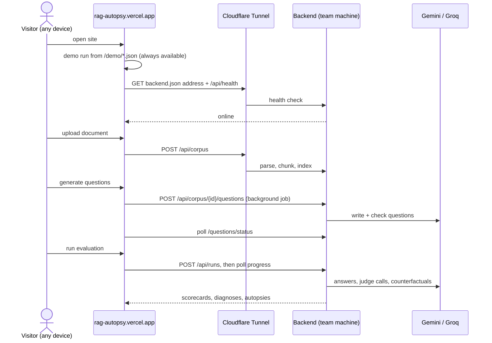

**Deploy or refresh the live site** (backend already running on `:8000`, Git Bash):

```bash
bash deploy/go-live.sh
```

It starts a Cloudflare quick tunnel (`cloudflared`), waits until the backend answers through it, builds the dashboard
with `VITE_STATIC=1`, writes `backend.json` with the tunnel address and deploys to Vercel. Keep the window open: uploads
work while the machine is on, awake and online; otherwise the site says "backend offline" and the demo still works.

**Refresh the built-in demo** after new runs: `scripts/export_static.py <bad_run_id> <fix_run_id>` and redeploy.

**Fully hosted alternative:** `deploy/hf-space/` packages the backend as a Hugging Face Docker Space (16 GB CPU).
Docker Spaces currently need a Hugging Face PRO subscription.

## API reference

| Method | Path | Purpose |
|---|---|---|
| `GET` | `/api/health` | Liveness check |
| `POST` | `/api/corpus` | Upload files (multipart) → parse, chunk, index → `{corpus_id, n_docs, n_chunks, files}` |
| `POST` | `/api/corpus/demo` | Load the bundled demo corpus |
| `GET` | `/api/corpus/{id}` | Corpus info |
| `POST` | `/api/corpus/{id}/questions` | Start test-set generation (202; runs in the background) |
| `GET` | `/api/corpus/{id}/questions/status` | `idle` / `running` / `done` / `error` |
| `GET` | `/api/corpus/{id}/questions` | The generated test set |
| `POST` | `/api/runs` | Start an evaluation `{corpus_id, config}` → `{run_id}` |
| `GET` | `/api/runs?corpus_id=` | Runs for a corpus |
| `GET` | `/api/runs/{id}` | Run overview + progress (`?full=true` for everything) |
| `GET` | `/api/runs/{id}/questions/{qid}` | One question's autopsy: trace, diagnosis, gold chunks |
| `POST` | `/api/runs/{id}/fix` | Re-test the failed questions with the prescribed (or a custom) config |
| `GET` | `/api/runs/{a}/diff/{b}` | Fixed / broken / unchanged + scorecard deltas |
| `GET` | `/api/runs/{id}/report.md` | Markdown root-cause report |

## Testing

```bash
cd backend
.venv/Scripts/python -m pytest
```

25 unit tests: parsing (including empty/scanned PDFs), chunking and offsets, evidence location and gold remapping,
leakage, the LLM client (cache, call counting, JSON repair, model output with or without a wrapper), every lens with
hand-made fixtures, consensus rules and prescriptions. The LLM is always mocked.

## Limitations and roadmap

**Limitations**
- Chunk size is counted in words, not tokens (~0.75 words per token).
- On CPU we use HHEM for grounding; MiniCheck is more accurate but needs a GPU.
- Free-tier LLM APIs have per-minute and per-day caps, so generating questions for an upload takes 1–3 minutes.
- Generated test questions can be imperfect; suspicious ones are flagged for human review rather than hidden.
- Consensus weights are hand-set for v1.
- Uploads on the hosted site depend on the team's machine being online.

**Roadmap**
- Batch judge checks and local-model inference for 3–5× faster runs.
- Leave-one-out lens, and multi-hop, paraphrase and distractor question types.
- Consensus weights learned from hand-labelled verdicts.
- A black-box adapter to evaluate any RAG endpoint (question in → answer + contexts out).
- Per-document failure heatmap, and a CI gate that runs an autopsy on every RAG change.

## Acknowledgements

Built at **HYPNEXIS'26**, the 36-hour hackathon at Manipal University Jaipur (Department of Computer and
Communications Engineering), for problem statement **AI-04: RAG Evaluation Pipeline**.

Research and tools it builds on: Lewis et al. 2020 (Retrieval-Augmented Generation), Es et al. 2023 (RAGAS),
Tang, Laban & Durrett 2024 (MiniCheck), Kovács & Recski 2025 (LettuceDetect), Vectara HHEM-2.1-Open,
Xiao et al. 2023 (BGE models), Cormack, Clarke & Büttcher 2009 (reciprocal rank fusion), Efron & Tibshirani 1993
(bootstrap), and FastAPI, ChromaDB, sentence-transformers, React and Tailwind CSS.
